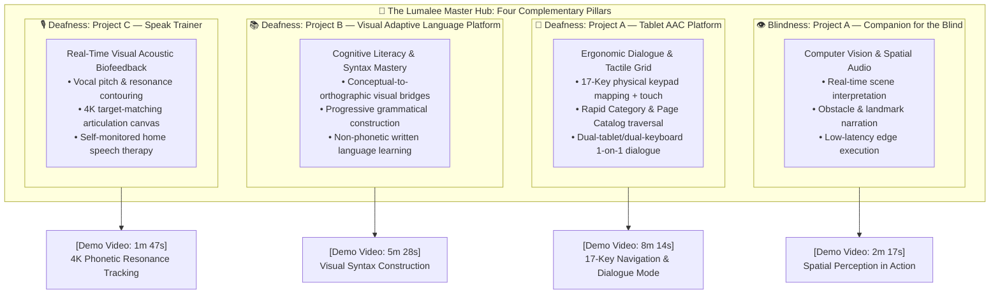
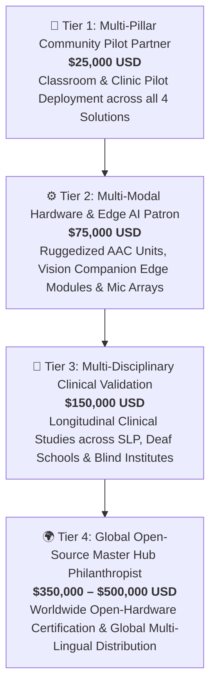
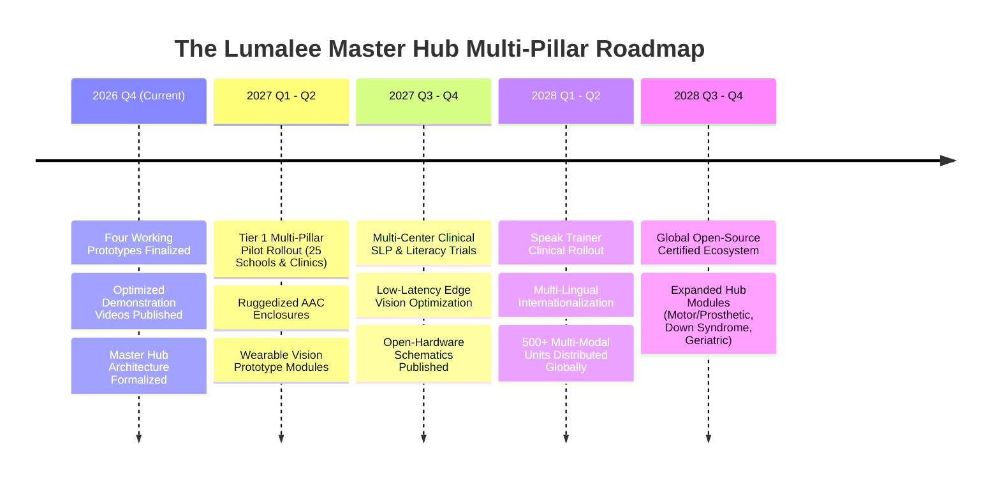

# 🌟 The Lumalee Project: AssistiveTech Solutions Hub
## 🏛️ Comprehensive Funding, Grant & Institutional Sponsorship Dossier

**A Strategic Proposal for Philanthropic Endowments, Accessibility Grant Committees, Corporate Social Impact Partners, and Research Foundations**

---

| Document Information | Details |
| :--- | :--- |
| **Project Lead & Principal Architect** | **Luis Angel Montiel Moreno** (Staff Principal Tech Lead & AI / Big Data Consultant) |
| **Organization / Repository** | [Lumalee-AssistiveTech-Solutions-Hub](https://github.com/luis-angel-montiel-moreno/Lumalee-AssistiveTech-Solutions-Hub) |
| **Current Stage** | Functional Working Prototypes & Verified Demonstration Phase |
| **Target Funding Scope** | **$50,000 – $500,000 USD** (Phased Pilot & Global Open-Hardware Scaling) |
| **Open-Source License** | [Apache License 2.0](LICENSE) |
| **Contact Email** | [induccion.genai.thc@gmail.com](mailto:induccion.genai.thc@gmail.com) |
| **LinkedIn Profile** | [linkedin.com/in/luis-angel-montiel-moreno-053160215](https://www.linkedin.com/in/luis-angel-montiel-moreno-053160215) |
| **Inquiries & Proposals** | Luis Angel Montiel Moreno / St. Joseph IT Services |

---

## 🕊️ Executive Summary: The Master Hub Vision

**The Lumalee Project** is an integrated **Master Hub of Assistive Technology Solutions** dedicated to engineering high-impact, accessible, and human-centered software and hardware systems for persons with disabilities. 

Rooted in the conviction that communication, sensory awareness, and learning are **fundamental human rights**, Lumalee bridges the gap between frontier technological capabilities and real-world daily accessibility. Rather than treating disabilities as isolated constraints with single-purpose gadgets, our master ecosystem creates **multi-modal sensory and cognitive bridges** that empower users to express their needs, learn formal languages, speak with confidence, and navigate their surroundings with independence and dignity.

### Core Architectural Premise: Unique, Distinct & Complementary Solutions
The Lumalee Hub is **not** a single product or interface. It is an orchestration of distinct, specialized initiatives—each engineered from first principles to address a specific sensory or communicative challenge, while interconnecting to form a unified, complementary support ecosystem:

1. **👁️ Blindness Companion (Project A)**: An intelligent computer vision and spatial audio companion for environmental perception, obstacle awareness, and autonomous mobility.
2. **🧏 Tablet AAC Communication Platform (Deafness Project A)**: An ergonomic, dual-mode (capacitive touch + tactile physical keypad mapping) augmentative dialogue system with nested catalogs, instant speech synthesis, and real-time peer dialogue.
3. **📚 Visual Adaptive Platform for Language Acquisition (Deafness Project B)**: An interactive cognitive framework that bridges visual imagery with written syntax and grammar, unlocking literacy and academic careers for pre-lingual deaf learners.
4. **🎙️ Speak Trainer for Deaf Persons (Deafness Project C)**: A real-time visual acoustic biofeedback coach that renders vocal pitch, volume, and formant resonance into high-definition visual targets for self-monitored speech articulation.

---

## 🚨 The Challenge: The Multi-Dimensional Crisis of Sensory & Communicative Deprivation

Globally, over **1.5 billion people** live with hearing loss, and more than **250 million** live with moderate to severe visual impairment. Millions more navigate autism, aphasia, intellectual disabilities, cognitive differences, and neurodegenerative conditions. 

These challenges manifest in distinct yet deeply intersecting barriers:

### 1. Spatial Disorientation & Navigational Anxiety (Blindness & Deafblindness)
Visually impaired individuals face daily physical hazards, cognitive exhaustion, and social dependency when navigating public spaces, transit, and unfamiliar environments. Conventional electronic travel aids are either prohibitively expensive or provide rudimentary beeping that fails to convey spatial context.

### 2. Expressive Frustration & Emotional Isolation (Deafness, Non-Verbal & Aphasia)
When individuals cannot communicate immediate physical, medical, or emotional needs to people who do not know sign language, chronic frustration turns inward. Clinical research demonstrates drastically elevated rates of depression, anxiety, and behavioral crises in deaf, non-verbal, and stroke-survivor populations.

### 3. The Written Literacy Chasm (Pre-Lingual Deaf Children & Dyslexia)
For pre-lingually deaf children, written words are abstract symbols disconnected from auditory phonetics. Without specialized visual scaffolds, high percentages of deaf students face functional illiteracy, locking them out of higher education, STEM disciplines, and skilled employment.

### 4. The Speech Self-Monitoring Deficit (Deaf Oral Articulation)
Without auditory feedback, individuals learning spoken language cannot hear their own pitch, vocal tone, or phoneme placement. Conventional speech therapy is geographically scarce, cost-prohibitive ($120–$250/hour), and lacks continuous at-home feedback tools.

### 5. The Commercial Assistive Industry Failure
The commercial assistive technology market is fundamentally broken:
* **Exorbitant Monopolistic Pricing**: Specialized hardware devices cost between **$3,000 and $9,000 USD** per unit.
* **Predatory Subscription Paywalls**: Software apps charge recurring monthly fees that underprivileged families, public schools, and developing-world clinics cannot sustain.
* **Rigid Single-Modal Designs**: Fragile, touchscreen-only devices break easily, lack tactile feedback for motor or deafblind users, and become obsolete when manufacturers abandon software updates.

---

## 💡 The Lumalee Portfolio: Four Complementary Technical Pillars

The Lumalee Master Hub is grounded in four verified, working prototypes, each possessing its own dedicated architecture, user interaction model, and demonstration evidence:

### Verified Demonstration Evidence:

> 📦 **Official GitHub Demonstrations Release**: [v1.0.0-demos](https://github.com/luis-angel-montiel-moreno/Lumalee-AssistiveTech-Solutions-Hub/releases/tag/v1.0.0-demos) — All videos are available for high-speed CDN streaming and direct download.

1. **[Blindness Project A — Companion for the Blind (2m 17s)](https://github.com/luis-angel-montiel-moreno/Lumalee-AssistiveTech-Solutions-Hub/releases/download/v1.0.0-demos/Project.A.-.Companion.for.blind_short.mp4)**
   * *Technology*: Edge computer vision, scene parsing, spatial audio synthesis.
   * *Clinical Goal*: Autonomous mobility, obstacle detection, and confident spatial navigation.

https://github.com/user-attachments/assets/c52c7667-1e56-4ee1-a6ab-7383e2173022

2. **[Deafness Project A — Tablet Augmentative Communication (AAC) System (8m 14s)](https://github.com/luis-angel-montiel-moreno/Lumalee-AssistiveTech-Solutions-Hub/releases/download/v1.0.0-demos/Project.A.-.Tablet.augmented.and.alternative.communication.system_short.mp4)**
   * *Technology*: Physical-to-virtual hardware mapping (17-key numeric keypad binding + touchscreen), nested Category/Page catalogs, TTS vocalization, haptic vibration, and real-time dual-tablet dialogue mode.
   * *Clinical Goal*: Instant, stress-free expression of complex phrases and bilateral dialogue between deaf and hearing persons.

https://github.com/user-attachments/assets/5ec7a152-f65c-464a-8442-142eb800370c

3. **[Deafness Project B — Visual Adaptive Platform for Language Acquisition (5m 28s)](https://github.com/luis-angel-montiel-moreno/Lumalee-AssistiveTech-Solutions-Hub/releases/download/v1.0.0-demos/Project.B.-.Visual.Adaptative.Platform.for.language.aquisition_short.mp4)**
   * *Technology*: Visual syntactic scaffolding, adaptive difficulty calibration, interactive grammar composition without phonetic prerequisites.
   * *Clinical Goal*: Full written reading and writing fluency, academic inclusion, and professional career readiness.

https://github.com/user-attachments/assets/6546d701-a9b4-48ff-983f-878f04a96539

4. **[Deafness Project C — Speak Trainer for Deaf Persons (1m 47s)](https://github.com/luis-angel-montiel-moreno/Lumalee-AssistiveTech-Solutions-Hub/releases/download/v1.0.0-demos/Project.C.-.Speak.trainer.for.deaf.persons_short.mp4)**
   * *Technology*: High-resolution acoustic FFT analysis, formant contour mapping, visual resonance biofeedback gamification.
   * *Clinical Goal*: Oral speech articulation, vocal pitch modulation, and self-directed speech rehabilitation without clinical dependency.

https://github.com/user-attachments/assets/9dadbbc7-a0aa-4683-8432-0348c0df5390

---

## 🌐 Expanded Scope of Disabilities & User Beneficiaries

While each of the four projects addresses a specific foundational barrier, the combined ergonomic, visual, and tactile capabilities of the Lumalee Hub provide life-changing utility across **11 interconnected user groups**:

  
  
<em>Figure 1: Cross-Sectional Scope of Users and Disabilities Empowered by the Lumalee Dialogue & Assistive Technology Platform.</em>

| Beneficiary Group | Key Barrier | Complementary Lumalee Intervention | Measurable Human Outcome |
| :--- | :--- | :--- | :--- |
| **🧠 Persons with Intellectual Disabilities (Core)** | Cognitive overload from complex, changing UI hierarchies. | Fixed spatial layout, instant audio/haptic cause-and-effect triggers across AAC and learning tools. | Enhanced cognitive autonomy, reduced agitation, routine mastery. |
| **🧏 Deaf & Non-Verbal Kids** | Cannot express emergent needs; isolated from non-signers. | 17-key rapid tactile AAC tablet + dual-tablet peer dialogue protocol. | Elimination of frustration-induced tantrums; immediate social inclusion with family. |
| **📚 Pre-Lingual Deaf Students** | High rate of functional illiteracy; abstract phonetic barrier. | Adaptive visual language acquisition platform (Project B). | Mastery of written reading and writing; access to STEM and technical careers. |
| **🎙️ Deaf Learning Oral Speech** | Inability to hear own vocal pitch and formant placement. | 4K visual speech resonance and articulation coach (Project C). | Clearer phonetic articulation; independent practice without therapist cost. |
| **🦯 Blind & Visually Impaired** | Spatial disorientation and navigation hazards in novel environments. | Sensory companion with low-latency audio spatial guidance (Project A). | Autonomous mobility; independent navigation of public and educational spaces. |
| **🤲 Blind & Deaf (Deafblind)** | Total absence of both sight and hearing; prohibitive cost of braille terminals. | 17-key mechanical tactile keypad navigated by muscle memory + haptics. | Restored physical communication channel without fragile braille displays. |
| **🧩 Autistic Individuals & Non-Verbal** | Overstimulation by complex touch interfaces; verbal shutdown. | Predictable physical 17-key numpad input with fixed navigation. | Reliable emotional expression; reduced sensory overload. |
| **💬 Aphasia & Stroke Survivors** | Loss of verbal fluency despite intact intellect; memory loss. | Visual category catalogs with high-contrast icon-based recall. | Restored daily autonomy and communication with medical staff and caregivers. |
| **⚡ Attention & Activity Disorders (ADHD)** | Distractibility from visual noise; slow multi-step interfaces. | Zero-latency physical keypad shortcuts with minimal visual clutter. | Rapid interaction matching the speed of active thought; sustained focus. |
| **📖 Dyslexia & Reading Challenges** | Inversion and cognitive exhaustion decoding text-heavy interfaces. | Iconographic buttons paired with multi-sensory text-to-speech audio. | Effortless comprehension without reading fatigue or shame. |
| **✍️ Functional Illiterate Adults & Youth** | Unable to read written instructions, transit, or medical menus. | Purely pictorial action buttons vocalizing full-sentence requests. | Independent civic navigation and dignified access to healthcare. |
| **🌍 Recent Immigrants & Non-Native Speakers** | Complete linguistic barrier; unable to read written local language. | Universal icon-to-speech translation with dual-dialogue mode. | Immediate ability to communicate in hospitals, transit, and social services. |
| **🎒 Kids & Primary School Students** | Early speech delays and reluctance to speak in classrooms. | Gamified visual language acquisition and low-stress dialogue tools. | Accelerated vocabulary development and classroom participation confidence. |
| **👵 Elderly in Assisted Living** | Decreased fine motor control; tremor prevents touch-screen typing. | Large, raised mechanical keypad buttons with high haptic response. | Independent emergency and medical request signaling without caregiver fatigue. |

---

## 🛠️ Software Craftsmanship & Open Architecture Principles

Every solution within the Lumalee Master Hub is built upon strict engineering discipline:

1. **Clean Architecture & Domain Separation**: Modular decoupling of domain logic, presentation controllers, and hardware adapters, ensuring long-term maintainability.
2. **Resilient Vanilla Frontend (Zero Fragile Dependencies)**: The AAC and educational interfaces utilize pure **Vanilla HTML5, CSS3, and ES6 JavaScript (MVC pattern)**. This eliminates framework obsolescence (React/Angular version churn), enables 60fps performance on $35 low-cost tablets, and guarantees decade-long device stability.
3. **Local-First & 100% Offline Resilience**: Communication and sensory awareness cannot depend on cloud connectivity. All core functions run locally without internet access, account logins, or recurring subscription fees.
4. **Physical & Visual Hardware Flexibility**: Software interfaces gracefully support touchscreen gestures, physical keyboard input (standard 17-key numeric keypads), high-definition external displays, and microphone sensor arrays.
5. **Open Source & Open Hardware**: Licensed under the **Apache License 2.0**, guaranteeing that the technology remains perpetually accessible, modifiable, and auditable by global schools, clinics, and developers.

---

## 💎 Multi-Pillar Sponsorship & Grant Investment Packages

We invite philanthropic institutions, accessibility grants, corporate social impact funds, and visionary benefactors to support the phased development, clinical validation, and deployment of the **entire Lumalee ecosystem**:

### 1. Tier 1: Multi-Pillar Community Pilot Partner ($25,000 USD)
* **Objective**: Deploy complete pilot evaluation packages across 25 partner institutions (deaf classrooms, blind rehabilitation centers, speech clinics, and special-needs programs).
* **Package Deliverables**:
  - 25 AAC Tablet + tactile keypad dialogue kits for non-verbal and deaf students.
  - 25 Visual Adaptive Language Acquisition stations for primary deaf literacy.
  - 10 Speak Trainer acoustic biofeedback coaching stations for speech therapy rooms.
  - 10 Blindness Companion edge prototype units for spatial mobility testing.
  - Comprehensive educator, clinician, and caregiver training guides.
  - 6-month qualitative and quantitative efficacy report across all four modalities.

### 2. Tier 2: Multi-Modal Hardware & Edge AI Patron ($75,000 USD)
* **Objective**: Advance physical hardware fabrication and embedded edge-computing infrastructure across the project lines.
* **Package Deliverables**:
  - **Deafness AAC**: Tooling and fabrication of 100 unified, shock-proof, child-resistant tablet enclosures integrating mechanical tactile keys and BLE connectivity.
  - **Blindness Companion**: Fabrication of 50 compact, wearable edge-AI vision and spatial audio modules (low-power, lightweight cameras with bone-conduction audio).
  - **Speak Trainer**: Calibration and packaging of high-fidelity acoustic microphone arrays and responsive visual display stations.
  - Pre-compliance electrical, battery safety, and accessibility testing (FCC/CE).

### 3. Tier 3: Multi-Disciplinary Clinical Validation & Longitudinal Study ($150,000 USD)
* **Objective**: Conduct rigorous, multi-cohort clinical and pedagogical longitudinal trials in partnership with accredited universities, speech-language pathologists (SLPs), deaf education institutes, and blindness organizations.
* **Package Deliverables**:
  - 12-month formal longitudinal study measuring:
    1. Communication retrieval speed and emotional well-being (AAC Platform).
    2. Reading comprehension and written syntax acquisition rates (Visual Adaptive Platform).
    3. Phoneme articulation accuracy and formant modulation improvement (Speak Trainer).
    4. Navigational confidence and obstacle avoidance autonomy (Blindness Companion).
  - Peer-reviewed, open-access publications in assistive technology and rehabilitation journals.
  - Development of clinical onboarding curricula for speech therapists and special education teachers.

### 4. Tier 4: Global Open-Source Master Hub Philanthropist ($350,000 – $500,000 USD)
* **Objective**: Scale the Lumalee Master Hub into a permanently endowed, worldwide open-source assistive ecosystem providing zero-cost software and low-cost open hardware blueprints to developing nations.
* **Package Deliverables**:
  - **Multi-Lingual Localization**: Translating the visual language platform, AAC phrase catalogs, and voice synthesizers into Spanish, English, French, Portuguese, Arabic, and written Sign Language notations.
  - **Ultra-Low-Cost Hardware Blueprints**: Publishing certified open-hardware schematics (printable 3D enclosures, off-the-shelf microcontroller firmware) enabling community makers, schools, and hospitals in Latin America, Africa, and Asia to assemble complete systems for under $40 USD.
  - **Expansion of Future Hub Modules**: Accelerating R&D for the expanding disability horizons: Motor/Prosthetic user interfaces, Down Syndrome cognitive tools, and geriatric communication tablets.

---

## 📊 Balanced Portfolio Budget Allocation

Capital is strategically balanced across software engineering, hardware fabrication, and direct clinical deployment across all divisions:

| Budget Category | Allocation (%) | Investment Scope ($150K Baseline) | Purpose & Deliverables |
| :--- | :---: | :---: | :--- |
| **Multi-Modal Hardware Fabrication** | **30%** | $45,000 | Rugged tablet enclosures, mechanical keypad integration, wearable vision modules, microphone arrays. |
| **Core Software, Vision & Biofeedback R&D** | **30%** | $45,000 | Computer vision edge narration, acoustic FFT resonance algorithms, visual syntax engine, peer dialogue protocol. |
| **Clinical Trials & Field Deployment** | **20%** | $30,000 | SLP clinician compensation, special-needs school field logistics, participant tracking, ethical oversight. |
| **Localization & Multi-Disability Content** | **10%** | $15,000 | Multi-language translation, sign language visual mapping, illustrated pedagogical curricula. |
| **Open-Source Governance & Safety** | **10%** | $15,000 | Apache 2.0 licensing stewardship, open-hardware certification, security audits, accessibility compliance. |

---

## 🗓️ Strategic Milestones & Roadmap (2026 – 2028)

---

## 👨‍💻 Principal Leadership Profile

**Luis Angel Montiel Moreno**  
*Staff Principal Tech Lead & AI / Big Data Consultant*  
*Founder, St. Joseph IT Services & The Lumalee Project Hub*

With extensive experience architecting enterprise distributed systems, high-throughput data platforms, and mission-critical software solutions, Luis Angel applies rigorous software craftsmanship (Clean Architecture, SOLID, test-driven validation, and low-latency systems engineering) to the assistive technology domain. 

Driven by an ethical imperative of universal charity and human dignity, he leads the design, technical implementation, and strategic trajectory of the Lumalee ecosystem, ensuring that every engineering decision directly serves the individual user without compromise.

---

## 📬 Formal Engagement & Partnership Channels

We welcome conversations with grant officers, institutional foundations, assistive technology departments, and philanthropic patrons.

* **Email**: [induccion.genai.thc@gmail.com](mailto:induccion.genai.thc@gmail.com)
* **LinkedIn**: [linkedin.com/in/luis-angel-montiel-moreno-053160215](https://www.linkedin.com/in/luis-angel-montiel-moreno-053160215)
* **GitHub Profile**: [@luis-angel-montiel-moreno](https://github.com/luis-angel-montiel-moreno)
* **Project Repository**: [github.com/luis-angel-montiel-moreno/Lumalee-AssistiveTech-Solutions-Hub](https://github.com/luis-angel-montiel-moreno/Lumalee-AssistiveTech-Solutions-Hub)
* **Master Demonstrations**: Located under `/demos` in the repository.

---

### **Join us in giving voice, literacy, and vision to millions.**

