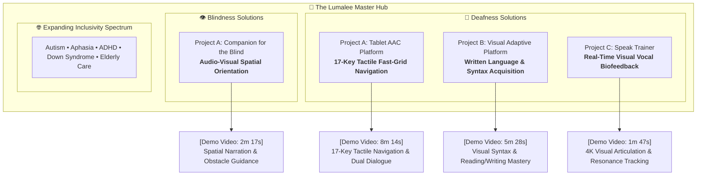
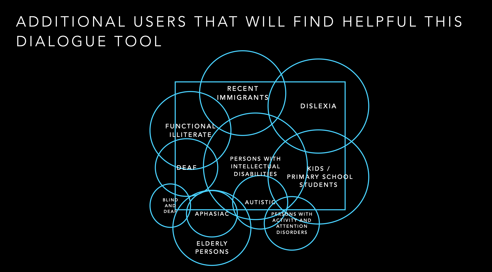
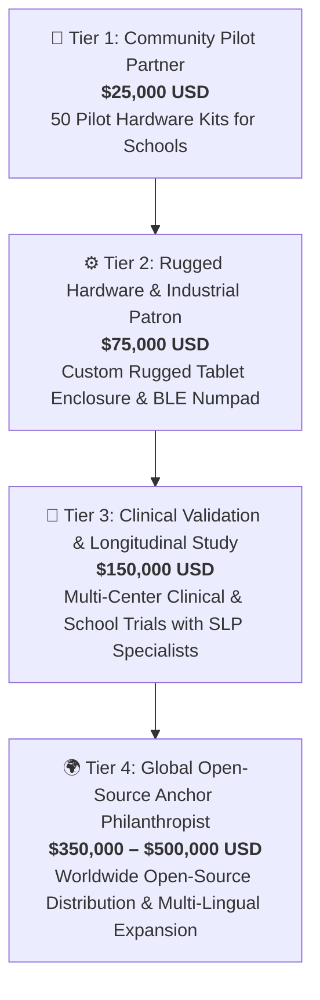
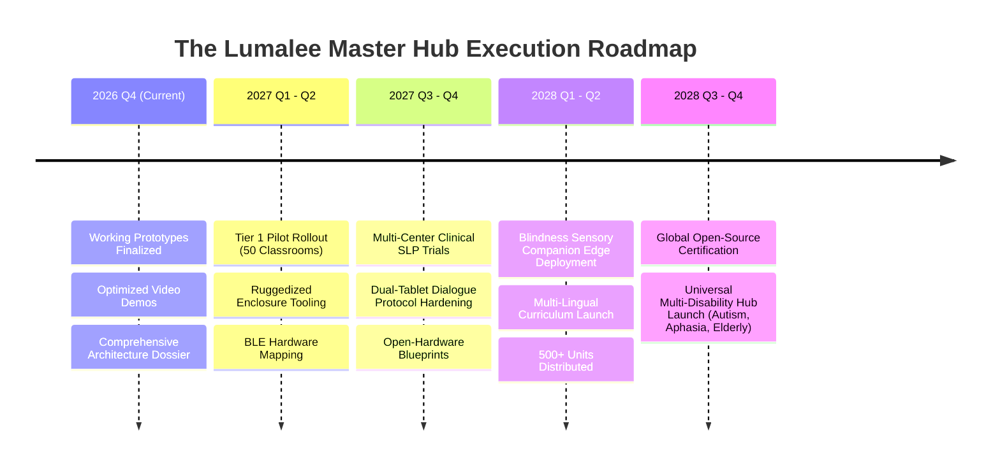

# 🌟 The Lumalee Project: AssistiveTech Solutions Hub
## 🏛️ Comprehensive Funding, Grant & Institutional Sponsorship Dossier

**A Proposal for Foundations, Philanthropic Endowments, Accessibility Grant Committees, and Corporate Social Impact Partners**

---

| Document Information | Details |
| :--- | :--- |
| **Project Lead & Principal Architect** | **Luis Angel Montiel Moreno** (Staff Principal Tech Lead & AI / Big Data Consultant) |
| **Organization / Repository** | [Lumalee-AssistiveTech-Solutions-Hub](https://github.com/luis-angel-montiel-moreno/Lumalee-AssistiveTech-Solutions-Hub) |
| **Current Stage** | Functional Working Prototypes & Verified Demonstration Phase |
| **Target Funding Scope** | **$50,000 – $500,000 USD** (Phased Pilot & Global Open-Hardware Scaling) |
| **Open-Source License** | [Apache License 2.0](LICENSE) |
| **Contact Email** | [induccion.genai.thc@gmail.com](mailto:induccion.genai.thc@gmail.com) |
| **Inquiries & Proposals** | Luis Angel Montiel Moreno / St. Joseph IT Services |

---

## 🕊️ Executive Manifesto: The Spiritual & Ethical Foundation

> ### *“The Works of Mercy as unity is the first essential and universal language incarnated and bearing fruit for every person since being a baby in their Mother’s womb.*  
> *Charity is the inherent shared language of God to every mother which in silence speaks louder than all the wisdom and techniques of the world shouting together.”*  
> 
> — **Luis Angel Montiel Moreno**

**The Lumalee Project** operates on the unwavering premise that human communication, literacy, and sensory autonomy are **inalienable rights**, not luxury goods. Technology achieves its highest moral purpose not when it entertains the privileged, but when it serves the vulnerable—giving voice to the non-verbal, literacy to the deaf, vision to the blind, and human dignity to all.

---

## 🚨 The Problem: The Severe Crisis of Communication and Sensory Deprivation

Globally, over **1.5 billion people** live with some degree of hearing loss, and more than **250 million** live with moderate to severe visual impairment. Millions more live with autism, aphasia, cognitive differences, and neurodegenerative disorders.

### The Deaf & Non-Verbal Dilemma:
1. **Severe Psychological Impact**: When deaf individuals cannot easily express their thoughts, pain, or basic daily decisions to people who do not know sign language, chronic frustration turns inward. Clinical research demonstrates drastically elevated rates of severe depression and anxiety in deaf and non-verbal populations.
2. **The Early Childhood Expression Void**: Deaf children require immediate, intuitive expression tools while they are still in the multi-year process of learning formal sign, written, or spoken languages. Without an immediate tool, critical emotional and cognitive developmental windows are missed.
3. **The Written Literacy Hurdle**: For pre-lingually deaf children, written phonetic words are abstract symbols disconnected from sound. Consequently, a vast percentage of deaf individuals worldwide struggle with functional literacy, preventing them from accessing technical education, professional careers, and economic self-sufficiency.
4. **The Speech Self-Monitoring Deficit**: Without auditory feedback, deaf individuals learning oral speech cannot self-correct pitch, volume, or phoneme articulation, leading to speech regression and isolation.

### The Assistive Technology Industry Failure:
Commercial Augmentative and Alternative Communication (AAC) systems are profoundly broken:
- **Exorbitant Costs**: Proprietary hardware AAC devices cost between **$3,000 and $9,000 USD** per unit.
- **Predatory Subscription Models**: Software apps charge steep recurring monthly fees that underprivileged families, orphanages, and developing-world schools cannot afford.
- **Cognitive & Motor Fragility**: Most apps are purely capacitive touchscreens with delicate, flat interfaces. They lack physical tactile feedback, making muscle-memory fast typing impossible for children, elderly users, or those with motor tremors.

---

## 💡 The Lumalee Solution: Multi-Modal AssistiveTech Master Hub

The Lumalee Project solves this crisis by combining **ergonomic physical hardware mapping**, **resilient zero-dependency software architecture**, and **visual biofeedback**.

### Core Technical Pillars:
1. **17-Key Physical Tactile Binding**: Bound to the standard, low-cost PC numeric keypad ($5 hardware), our AAC system creates a tactile, muscle-memory-driven communication grid with zero need to look at the screen.
2. **Vanilla MVC Architecture**: Built with pure HTML5, CSS3, and ES6 JavaScript. No framework bloat, no third-party vendor lock-in, and instant execution on $30 refurbished Android/Linux/Windows tablets.
3. **Local-First & 100% Offline**: Zero cloud dependencies. Operates seamlessly in rural schools, disaster zones, or environments without internet connectivity.
4. **Multi-Disability Modular Core**: Extensible across Deafness, Blindness, Autism, Aphasia, and Geriatric assistance.

---

## 🎬 Proven Prototypes & Video Demonstrations

The Lumalee Master Hub is not a theoretical concept. It is backed by four verified, operational software/hardware platforms ready for clinical pilot deployment:

### Direct Demonstration Evidence:

1. **[Deafness Project A — Tablet AAC System (8 min 14 sec)](demos/deafness-assistiveTech-solutions/Project%20A%20-%20Tablet%20augmented%20and%20alternative%20communication%20system_short.mp4)**
   * *Features demonstrated*: 17-key physical keypad mapping; rapid Category and Page Catalog navigation; customizable phrase buttons with text-to-speech, color, and haptic vibration; dual-device real-time dialogue mode between two non-connected tablets or keyboards; predictive phrase carousels.
2. **[Deafness Project B — Visual Adaptive Language Acquisition (5 min 28 sec)](demos/deafness-assistiveTech-solutions/Project%20B%20-%20Visual%20Adaptative%20Platform%20for%20language%20aquisition_short.mp4)**
   * *Features demonstrated*: Progressive visual scaffolds linking concepts directly to written syntax and grammar; interactive spelling and sentence composition; self-paced mastery for deaf learners.
3. **[Deafness Project C — Speak Trainer for Deaf Persons (1 min 47 sec)](demos/deafness-assistiveTech-solutions/Project%20C%20-%20Speak%20trainer%20for%20deaf%20persons_short.mp4)**
   * *Features demonstrated*: Real-time acoustic capture rendering vocal pitch, volume, and formant resonance onto a high-definition visual biofeedback canvas; interactive articulation target-matching without requiring auditory perception.
4. **[Blindness Project A — Companion for the Blind (2 min 17 sec)](demos/blindness-assistiveTech-solutions/Project%20A%20-%20Companion%20for%20blind_short.mp4)**
   * *Features demonstrated*: Environmental scene perception; contextual spatial narration; low-latency audio guidance for independent mobility.

---

## 🎯 Target Beneficiary Impact Matrix & Scope of Disabilities

Our architecture extends far beyond deaf and blind individuals to address a universal cross-section of 11 distinct communication, cognitive, and sensory groups:

  
  
<em>Figure 1: Cross-Sectional Scope of Additional Users and Disabilities Empowered by the Lumalee Dialogue & Assistive Technology Platform.</em>

| Beneficiary Group | Key Barrier | Lumalee Intervention | Measurable Human Outcome |
| :--- | :--- | :--- | :--- |
| **🧠 Persons with Intellectual Disabilities (Core)** | Cognitive overload from complex, changing UI hierarchies. | Fixed spatial layout, instant audio/haptic cause-and-effect triggers. | Enhanced cognitive autonomy, reduced agitation, routine mastery. |
| **🧏 Deaf & Non-Verbal Kids** | Cannot express emergent needs; isolated from non-signers. | 17-key rapid tactile AAC tablet + dual-tablet peer dialogue. | Elimination of frustration-induced tantrums; immediate social inclusion with family. |
| **📚 Pre-Lingual Deaf Students** | High rate of functional illiteracy; abstract phonetic barrier. | Adaptive visual language acquisition platform (Project B). | Mastery of written reading and writing; access to STEM and technical careers. |
| **🎙️ Deaf Learning Oral Speech** | Inability to hear own vocal pitch and formant placement. | 4K visual speech resonance and articulation coach (Project C). | Clearer phonetic articulation; independent practice without therapist cost. |
| **🦯 Blind & Visually Impaired** | Spatial disorientation and navigation hazards in novel environments. | Sensory companion with low-latency audio spatial guidance (Project A). | Autonomous mobility; independent navigation of public and educational spaces. |
| **🤲 Blind & Deaf (Deafblind)** | Total absence of both sight and hearing; cost of braille terminals. | 17-key mechanical tactile keypad navigated by muscle memory + haptics. | Restored physical communication channel without fragile braille displays. |
| **🧩 Autistic Individuals & Non-Verbal** | Overstimulation by complex touch interfaces; verbal shutdown. | Predictable physical 17-key numpad input with fixed navigation. | Reliable emotional expression; reduced sensory overload. |
| **💬 Aphasia & Stroke Survivors** | Loss of verbal fluency despite intact intellect; memory loss. | Visual category catalogs with high-contrast icon-based recall. | Restored daily autonomy and communication with medical staff and caregivers. |
| **⚡ Attention & Activity Disorders (ADHD)** | Distractibility from visual noise; slow multi-step interfaces. | Zero-latency physical keypad shortcuts with minimal visual clutter. | Rapid interaction matching the speed of active thought; sustained focus. |
| **📖 Dyslexia & Reading Challenges** | Inversion and cognitive exhaustion decoding text-heavy interfaces. | Iconographic buttons paired with multi-sensory text-to-speech audio. | Effortless comprehension without reading fatigue or shame. |
| **✍️ Functional Illiterate Adults & Youth** | Unable to read written instructions, transit, or medical menus. | Purely pictorial action buttons vocalizing full-sentence requests. | Independent civic navigation and dignified access to healthcare. |
| **🌍 Recent Immigrants & Non-Native Speakers** | Complete linguistic barrier; unable to read written local language. | Universal icon-to-speech translation with dual-dialogue mode. | Immediate ability to communicate in hospitals, transit, and social services. |
| **🎒 Kids & Primary School Students** | Early speech delays and reluctance to speak in classrooms. | Gamified visual language acquisition and low-stress dialogue tools. | Accelerated vocabulary development and classroom participation confidence. |
| **👵 Elderly in Assisted Living** | Decreased fine motor control; tremor prevents touch-screen typing. | Large, raised mechanical keypad buttons with high haptic response. | Independent emergency and medical request signaling without caregiver fatigue. |

---

## 💎 Sponsorship & Grant Investment Packages

We invite philanthropic institutions, accessibility grants, corporate sponsors, and private benefactors to partner with us across four distinct investment tiers:

### 1. Tier 1: Community Pilot Partner ($25,000 USD)
* **Goal**: Manufacture and deploy **50 complete Lumalee AAC hardware kits** (ruggedized 10-inch tablets + 17-key tactile numeric keypads + preloaded software) directly into underfunded deaf education classrooms and special-needs clinics.
* **Deliverables**:
  - Direct field distribution of 50 fully operational units.
  - Teacher, therapist, and parent training handbooks.
  - 6-month qualitative feedback report on communication speed and depression reduction.
  - Prominent institutional recognition in open-source repositories and publications.

### 2. Tier 2: Rugged Hardware & Industrial Design Patron ($75,000 USD)
* **Goal**: Transform commercial off-the-shelf assemblies into a **dedicated, custom-engineered, child-proof, ruggedized assistive device**.
* **Deliverables**:
  - Industrial design and tooling for an integrated shock-absorbent enclosure housing both tablet and mechanical 17-key tactile switches.
  - Custom ultra-low-latency Bluetooth Low Energy (BLE) / USB-C integrated keypad controller.
  - Production run of 150 first-generation unified Lumalee Tablet units.

### 3. Tier 3: Clinical Validation & Multi-Center Longitudinal Study ($150,000 USD)
* **Goal**: Conduct rigorous, peer-reviewed clinical validation in partnership with accredited universities, speech-language pathologists (SLPs), and deaf institutes.
* **Deliverables**:
  - 12-month formal longitudinal study measuring vocabulary acquisition rates, articulation improvement (Speak Trainer), and psychological well-being metrics.
  - Publication of open-access research papers on tactile-assisted AAC efficacy.
  - CE and FCC regulatory pre-compliance testing for assistive hardware.

### 4. Tier 4: Global Open-Source Anchor Philanthropist ($350,000 – $500,000 USD)
* **Goal**: Establish Lumalee as a permanent, globally available, open-source assistive ecosystem providing free software and low-cost hardware specifications to developing nations.
* **Deliverables**:
  - Multi-lingual localization into Spanish, English, French, Portuguese, Arabic, and regional Sign Language written notations.
  - Cloud-free, edge-AI multi-modal sensory engine running the Blindness Companion and Speak Trainer natively on sub-$100 microcomputers (e.g., Raspberry Pi 5 / RK3588).
  - Creation of an open hardware certified repository allowing anyone with a 3D printer and $30 in parts to assemble a life-changing communication device anywhere in the world.

---

## 📊 Transparent Budget Allocation

Every dollar invested is strategically channeled directly into hardware fabrication, engineering excellence, and direct patient/student deployment:

| Budget Category | Allocation (%) | Investment Scope ($150K Baseline) | Purpose & Deliverables |
| :--- | :---: | :---: | :--- |
| **Hardware Tooling & Fabrication** | **35%** | $52,500 | Tooling, PCBs, mechanical key switches, injection molds, pilot tablet units. |
| **Core Software & Biofeedback R&D** | **25%** | $37,500 | Advancing the real-time acoustic resonance engine, dual-tablet dialogue, and edge AI. |
| **Clinical Trials & Field Deployment** | **20%** | $30,000 | SLP practitioner compensation, student tracking, ethical compliance, field logistics. |
| **Localization & Accessibility Guides** | **10%** | $15,000 | Multi-language translation, visual pedagogical curriculum, illustrated user manuals. |
| **Open-Source Governance & Safety** | **10%** | $15,000 | Open hardware licensing, security auditing, documentation, legal and IP stewardship. |

---

## 🗓️ Strategic Milestones & Roadmap (2026 – 2028)

---

## 👨‍💻 Principal Leadership Profile

**Luis Angel Montiel Moreno**  
*Staff Principal Tech Lead & AI / Big Data Consultant*  
*Founder, St. Joseph IT Services & The Lumalee Project Hub*

With extensive experience architecting enterprise distributed systems, high-throughput data platforms, and mission-critical software solutions, Luis Angel applies rigorous software craftsmanship (Clean Architecture, SOLID, test-driven validation, and low-latency systems engineering) to the assistive technology domain. 

Driven by an ethical imperative of universal charity and human dignity, he leads the design, technical implementation, and strategic trajectory of the Lumalee ecosystem, ensuring that every engineering decision directly serves the individual user without compromise.

---

## 📬 Formal Engagement & Partnership Channels

We welcome conversations with grant officers, institutional foundations, assistive technology departments, and philanthropic patrons.

* **Email**: [induccion.genai.thc@gmail.com](mailto:induccion.genai.thc@gmail.com)
* **LinkedIn**: [linkedin.com/in/luis-angel-montiel-moreno-053160215](https://www.linkedin.com/in/luis-angel-montiel-moreno-053160215)
* **GitHub Profile**: [@luis-angel-montiel-moreno](https://github.com/luis-angel-montiel-moreno)
* **Project Repository**: [github.com/luis-angel-montiel-moreno/Lumalee-AssistiveTech-Solutions-Hub](https://github.com/luis-angel-montiel-moreno/Lumalee-AssistiveTech-Solutions-Hub)
* **Master Demonstrations**: Located under `/demos` in the repository.

---

### *“In silence, charity speaks louder than all the wisdom and techniques of the world shouting together.”*

**Join us in giving voice, literacy, and vision to millions.**

