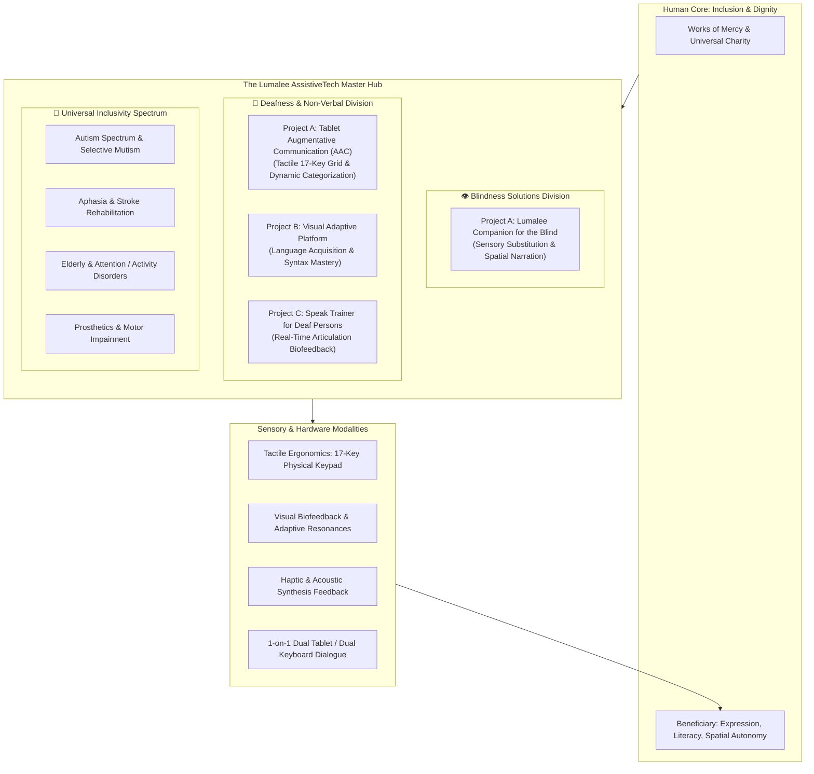
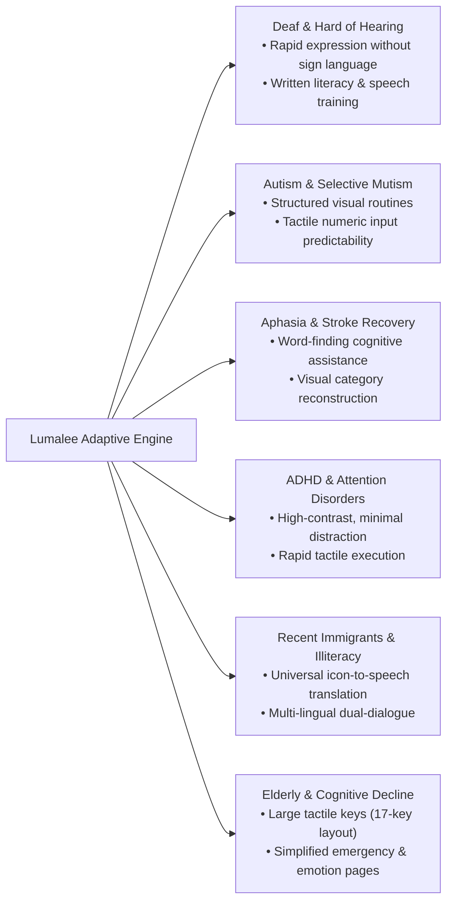

# Lumalee-AssistiveTech-Solutions-Hub

# 🌟 The Lumalee Project: AssistiveTech Solutions Hub
### *Engineering Human Dignity, Inclusive Communication, and Sensory Autonomy*

---

> ### 🕊️ The Philosophical & Spiritual Manifesto
> 
> *“The Works of Mercy as unity is the first essential and universal language incarnated and bearing fruit for every person since being a baby in their Mother’s womb.*  
> *Charity is the inherent shared language of God to every mother which in silence speaks louder than all the wisdom and techniques of the world shouting together.”*  
> 
> — **Luis Angel Montiel Moreno**

---

## 📖 Executive Summary & Master Hub Vision

**The Lumalee Project** is an integrated **Master Hub of Assistive Technology Solutions** dedicated to engineering high-impact, accessible, and human-centered software and hardware systems for persons with disabilities. 

Rooted in the conviction that communication, sensory awareness, and learning are fundamental human rights, Lumalee bridges the gap between complex technological capabilities and real-world daily accessibility. Rather than treating disabilities as isolated constraints, our master ecosystem creates **multi-modal sensory bridges** that empower users to express their needs, learn formal languages, speak with confidence, and navigate their surroundings with independence and dignity.

This repository serves as the central orchestration hub for multiple specialized assistive technologies, currently spanning **Blindness & Visual Impairment**, **Deafness & Non-Verbal Communication**, with architectural blueprints extending to **Autism Spectrum**, **Aphasia**, **Motor & Prosthetic Rehabilitation**, and **Down Syndrome**.

---

## 🏛️ System Architecture: The Multi-Modal Hub

The following architecture illustrates how Lumalee channels multi-sensory computing, tactile ergonomics, and adaptive intelligence into unified assistive platforms:

---

## 🎬 Project Portfolio & Interactive Video Demonstrations

Each solution in the Lumalee Hub has been engineered into working, verified prototypes with complete video demonstrations available directly in this repository.

### 🎥 Demonstration Video Quick-Access Table

| Division | Project Name | Focus & Innovation | Video Demonstration | Target Format / Size |
| :--- | :--- | :--- | :---: | :---: |
| **Blindness** | **Project A — Companion for Blind** | Audio-visual spatial perception & daily environment companion | [▶️ Watch Demo Video](demos/blindness-assistiveTech-solutions/Project%20A%20-%20Companion%20for%20blind_short.mp4) | H.264 MP4 (26 MB) |
| **Deafness** | **Project A — Tablet AAC System** | 17-key tactile keypad AAC tablet with rapid page/category navigation | [▶️ Watch Demo Video](demos/deafness-assistiveTech-solutions/Project%20A%20-%20Tablet%20augmented%20and%20alternative%20communication%20system_short.mp4) | H.264 MP4 (27 MB) |
| **Deafness** | **Project B — Visual Adaptive Platform** | Interactive visual framework for reading, writing & language acquisition | [▶️ Watch Demo Video](demos/deafness-assistiveTech-solutions/Project%20B%20-%20Visual%20Adaptative%20Platform%20for%20language%20aquisition_short.mp4) | H.264 MP4 (34 MB) |
| **Deafness** | **Project C — Speak Trainer** | Visual acoustic biofeedback & vocal resonance coach for deaf persons | [▶️ Watch Demo Video](demos/deafness-assistiveTech-solutions/Project%20C%20-%20Speak%20trainer%20for%20deaf%20persons_short.mp4) | H.264 MP4 (67 MB) |

---

### Detailed Solution Dossier

#### 1. 👁️ Blindness Solutions: Project A — Companion for the Blind
* **Sub-Repository**: [`Lumaleee-Blind-AssistiveTech-Solutions-Hub/lumalee-companion-for-blind`](Lumaleee-Blind-AssistiveTech-Solutions-Hub/)
* **Demo File**: [`demos/blindness-assistiveTech-solutions/Project A - Companion for blind_short.mp4`](demos/blindness-assistiveTech-solutions/Project%20A%20-%20Companion%20for%20blind_short.mp4)
* **The Challenge**: Visually impaired persons navigate a world predominantly designed for sighted individuals, facing physical navigation hazards, cognitive fatigue, and barriers to independent environmental perception.
* **The Solution**: An intelligent sensory companion providing real-time audio and contextual feedback. It captures environmental feeds, parses spatial orientation, identifies everyday obstacles, and converts spatial cues into low-latency verbal and acoustic feedback, granting the user autonomous environmental confidence.
* **Key Capabilities**:
  - Contextual scene interpretation and spatial narration.
  - Tactile and acoustic orientation guidance.
  - Mobile, low-power edge-executable design.

---

#### 2. 🧏 Deafness Solutions: Project A — Tablet Augmentative & Alternative Communication (AAC) System
* **Demo File**: [`demos/deafness-assistiveTech-solutions/Project A - Tablet augmented and alternative communication system_short.mp4`](demos/deafness-assistiveTech-solutions/Project%20A%20-%20Tablet%20augmented%20and%20alternative%20communication%20system_short.mp4)
* **The Challenge**: Deaf individuals—especially non-verbal children or those without immediate access to sign-language fluent conversation partners—often struggle to communicate basic needs, leading to emotional isolation and depression. Traditional software AAC systems are slow, cognitively overwhelming, and touch-screen only (lacking tactile feedback).
* **The Solution**: An advanced AAC platform featuring strict **physical-to-virtual hardware mapping**. Bound to an affordable standard 17-key PC numeric keypad (and touch display), users can navigate nested categories and pages at lightning speed, triggering vocalized sentences, haptic responses, and structured replies.
* **Key Capabilities**:
  - **17-Key Numerical Binding**: Dedicated hardware controls (`NumLock`, `/`, `*`, `-`) for instant navigation between Category Catalogs and Page Catalogs.
  - **Dynamic Action Buttons**: Customizable phrases, text-to-speech synthesis, icons, colors, sound effects, and haptic vibration triggers.
  - **Dual-Device Dialogue Protocol**: Supports connecting two independent tablets or dual physical keyboards for real-time 1-on-1 dialogue between a deaf individual and a hearing person.
  - **Speech Command Detection**: Capable of listening to surrounding speech, transcribing it in real time onto the tablet display, and updating predictive quick-response buttons.
  - **Predictive Carousel**: Real-time phrase predictive suggestions navigated seamlessly via arrow keys.

---

#### 3. 📚 Deafness Solutions: Project B — Visual Adaptive Platform for Language Acquisition
* **Demo File**: [`demos/deafness-assistiveTech-solutions/Project B - Visual Adaptative Platform for language aquisition_short.mp4`](demos/deafness-assistiveTech-solutions/Project%20B%20-%20Visual%20Adaptative%20Platform%20for%20language%20aquisition_short.mp4)
* **The Challenge**: For deaf children who have never heard spoken language, learning to read and write written phonetic language is like deciphering an abstract code. Without written literacy, individuals are blocked from higher education, professional careers, and modern digital society.
* **The Solution**: An adaptive, highly visual learning environment that connects conceptual mental imagery with written orthography and grammatical syntax without requiring auditory phonetics.
* **Key Capabilities**:
  - Progressive visual scaffolds translating concepts into vocabulary and written sentence structures.
  - Adaptive difficulty calibration that matches the learner's cognitive pace.
  - Interactive grammar construction modules designed specifically for deaf cognitive processing patterns.
  - Proven pathway to empower deaf students to excel in formal primary, secondary, and professional educational environments.

---

#### 4. 🎙️ Deafness Solutions: Project C — Speak Trainer for Deaf Persons
* **Demo File**: [`demos/deafness-assistiveTech-solutions/Project C - Speak trainer for deaf persons_short.mp4`](demos/deafness-assistiveTech-solutions/Project%20C%20-%20Speak%20trainer%20for%20deaf%20persons_short.mp4)
* **The Challenge**: Deaf persons learning to speak face the fundamental obstacle of not being able to hear their own vocal output to modulate pitch, tongue placement, vowel formants, and volume. Conventional speech therapy is often cost-prohibitive, geographically inaccessible, and frustrating.
* **The Solution**: An ultra-high-precision, real-time visual speech coaching platform. It analyzes acoustic input via microphone and renders instantaneous, intuitive visual biofeedback (pitch contours, phonetic resonance maps, and articulation targets) on a 4K interface.
* **Key Capabilities**:
  - Real-time vocal pitch, resonance, and formant contour tracking.
  - Visual target-matching gamification, allowing learners to see when their articulation matches target phonetic frequencies.
  - Visual feedback for volume, breath support, and consonant-vowel transitions.
  - Self-guided, stress-free practice at home without clinical dependency.

---

## 🌍 The Universal Inclusivity Matrix

While initially designed for deaf and blind beneficiaries, the underlying ergonomic, cognitive, and linguistic architecture of Lumalee inherently supports a broad spectrum of human communication needs:

---

## 🛠️ Software Craftsmanship & Engineering Standards

The Lumalee codebases strictly follow enterprise-grade software engineering and assistive-hardware principles:

1. **Clean Architecture & Separation of Concerns**: Strict boundary enforcement across Domain Entities, Use Cases, Repositories, and Presentation controllers.
2. **Resilient Vanilla Frontend (Zero Fragile Dependencies)**: The tablet AAC frontend is constructed with high-performance **Vanilla HTML5, CSS3, and ES6 JavaScript (MVC pattern)**, ensuring that assistive hardware runs reliably on low-cost devices without framework bloat, breakages, or forced obsolescence.
3. **Physical-to-Virtual Keystroke Synchronization**: Every on-screen element mirrors physical keyboard events (`handleKeyDown`), allowing seamless transition between physical tactile keypads and capacitive touch screens.
4. **Local-First & Offline Resilience**: Communication is essential to life. Lumalee applications are designed to operate 100% offline without mandatory internet connections or recurring software subscriptions.
5. **Universal Video & Media Standards**: All demonstrations and media assets are compiled to web-optimized H.264/AAC MP4 formats (`+faststart`, `yuv420p`), guaranteeing immediate playback across all modern browsers and GitHub previews.

---

## 🤝 Funding, Sponsorship & Institutional Partnership

To accelerate the transition of these prototypes into clinical trials, certified hardware units, and distributed open-source tools for schools and clinics, we have prepared an extensive **Institutional Funding & Sponsorship Dossier**:

👉 **[Read the Full Funding & Sponsorship Dossier](FUNDING_AND_SPONSORSHIP_DOSSIER.md)**

### How You Can Help
- **Philanthropic Grants & Foundation Funding**: Direct grant capital to manufacture physical 17-key tablet units for underprivileged deaf/blind schools.
- **Corporate Tech Sponsorship (Hardware/Cloud/AI)**: In-kind hardware donations (tablets, numeric keypads, edge AI chips) and computational resources.
- **Clinical & Research Partnerships**: Collaboration with speech pathologists, deaf education institutes, and accessibility researchers for clinical validation.
- **Open-Source Contributors**: Senior engineers passionate about Clean Architecture, accessibility, and assistive hardware.

---

## 👤 Project Leadership & Contact

**Luis Angel Montiel Moreno**  
*Staff Principal Tech Lead & AI / Big Data Consultant*  
*Founder & Lead Architect, The Lumalee Project*

- **GitHub**: [@luis-angel-montiel-moreno](https://github.com/luis-angel-montiel-moreno)
- **Organization**: St. Joseph IT Services / Lumalee AssistiveTech Hub

---

“Faith working through love — engineering technology that leaves no human being behind.”

